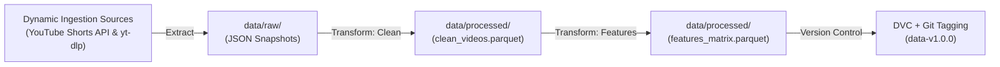
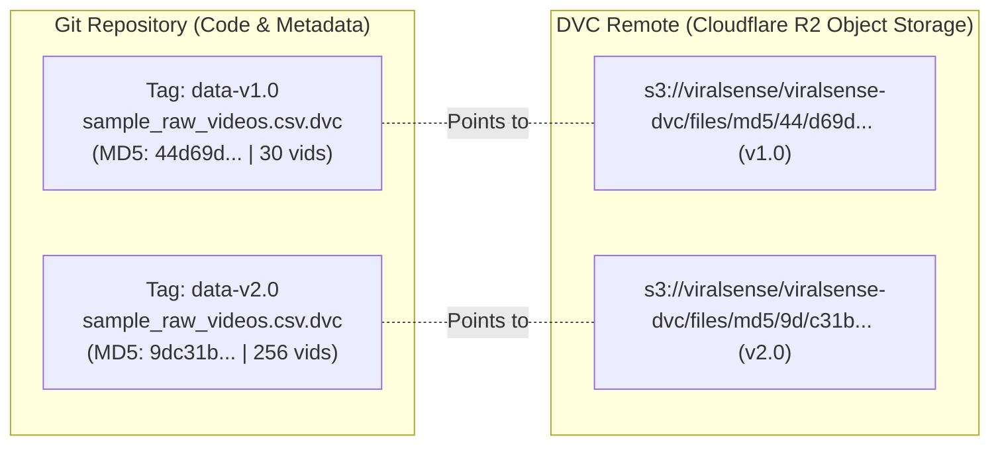

# ViralSense: Social Media Virality Prediction & Trend Saturation Detection Engine

[](https://www.python.org/downloads/release/python-3100/)
[](https://mlflow.org/)
[](https://github.com/features/codespaces)
[](https://opensource.org/licenses/MIT)

ViralSense is an end-to-end MLOps pipeline featuring continual learning capabilities, engineered to forecast early virality scores for short-form video content (YouTube Shorts) and identify trend lifecycle stages (early-rise, peak, and saturated). The system addresses real-world constraints such as label latency, concept drift, and API quota limits through an automated, staged machine learning workflow.

---

## Key Objectives & Problem Domain

The lifecycle of short-form digital content is exceptionally brief, often decaying within days or a few weeks before reaching audience fatigue. ViralSense resolves this bottleneck by:
* Predicting content virality early via interaction growth rates (views, likes, comments, shares).
* Classifying trend phases using the slope of virality scores over time.
* Mitigating label latency by isolating immature observations from final evaluation datasets during a 3–7 day maturation window.
* Monitoring covariate shift and concept drift to trigger adaptive model retraining.
* Assisting content creators and digital marketing teams in discovering emerging viral opportunities and optimizing promotional content strategies.

---

## Data Pipeline Architecture

Data is ingested periodically via an automated ETL pipeline, cleaned, feature-engineered, and versioned using DVC prior to consumption by machine learning models.



For complete technical specifications and architectural design, refer to **[docs/data_pipeline_architecture.md](docs/data_pipeline_architecture.md)**.

---

## Directory Structure

This repository adheres to the **Cookiecutter Data Science** standard:

```text
├── .devcontainer/         # GitHub Codespaces container setup and reproducibility config
├── config/                # Pipeline parameter files (config.yaml)
├── data/
│   ├── external/          # Auxiliary trend signals (Google Trends)
│   ├── processed/         # Cleaned, feature-engineered datasets (Parquet)
│   └── raw/               # Raw batch snapshots extracted from APIs and feeds
│       └── youtube/       # YouTube Shorts snapshots
├── docs/                  # Technical design and architecture documentation
├── models/                # Serialized model artifacts and experiment weights
├── notebooks/             # Exploratory Data Analysis (EDA) and prototype notebooks
├── src/                   # Production-grade source code
│   ├── __init__.py
│   ├── ingest_data.py     # Unified dynamic data ingestion & periodic simulation script
│   ├── preprocess.py      # Automated preprocessing (tokenization, stopwords, missing values)
│   ├── data/              # Modular data extraction and validation modules
│   │   ├── clean.py       # Data cleaning, deduplication, and schema validation
│   │   └── ingest_youtube.py # YouTube Data API v3 and trending ingestion
│   ├── features/          # Tabular metric computation and text vectorization
│   │   └── build_features.py # Velocity, engagement rates, and label generation
│   └── models/            # Staged regression and classification pipelines
├── .env.example           # Template for environment variables and API keys
├── .gitignore             # Standard Python/ML git ignore configuration
├── LICENSE                # Project license (MIT)
├── requirements.txt       # Core project dependencies
└── README.md              # Project documentation
```

---

## Pipeline Execution Guide

### 1. Environment Setup
Install project dependencies and configure environment variables:
```bash
cp .env.example .env
pip install -r requirements.txt
```

### 2. Data Ingestion (Dynamic & Continual Learning Ready)
Dynamic data extraction is orchestrated using `src/ingest_data.py`. This module pulls short-form content from **YouTube Shorts**, providing a non-destructive periodic simulation mechanism (*append-only timestamped snapshots*) to support **Continual Learning**.

```bash
# 1. Execute a single ingestion run for YouTube Shorts
python src/ingest_data.py --source youtube

# 2. Periodic simulation (Continual Learning: e.g., 3 cycles with a 5-second interval)
# Each cycle generates a distinct timestamped JSON snapshot without overwriting historical batches
python src/ingest_data.py --source youtube --runs 3 --interval 5
```

**Raw Snapshot Storage Layout:**
* `data/raw/youtube/{YYYY-MM-DD}/youtube_trending_{HHMMSS}.json`
* `data/raw/sample_raw_videos.csv` (consolidated sample snapshot in tabular CSV format)

### 3. Automated Preprocessing & NLP Cleaning
Raw data preprocessing is automated via `src/preprocess.py` to cleanse and prepare snapshots prior to feature extraction:

```bash
python src/preprocess.py
```

**Preprocessing Workflow:**
1. **Snapshot Aggregation**: Recursively ingests all historical snapshot batches from `data/raw/`.
2. **Missing Value Imputation**: Imputes numeric interaction metrics (`views`, `likes`, `comments`, `shares`) with `0` and trims whitespace on textual features.
3. **Composite Deduplication**: Eliminates duplicate entries based on `(platform, video_id)`, retaining the latest interaction snapshot.
4. **Short-Form Content Validation**: Filters and retains video content with duration $\le 60$ seconds.
5. **Text Sanitization & Hashtag Extraction**: Strips URLs, removes `@user` mentions, and parses hashtags into `extracted_hashtags`.
6. **Tokenization**: Splits clean sentences into word tokens populated in the `tokens` column.
7. **Stopword Removal**: Eliminates common Indonesian and English stopwords in-memory without external download dependencies, populating `clean_tokens` and `clean_text_final`.
8. **Dual-Format Export**: Persists clean data to `data/processed/clean_videos.parquet` (optimized for ML training) and `data/processed/clean_videos.csv` (human-readable inspection).

### 4. Feature Engineering
Compute velocity metrics (views/hour, likes/hour), engagement ratios, content signals, and virality ground-truth labels:
```bash
python src/features/build_features.py
```

### 5. Automated Pipeline Unit Testing
Execute the test suite to validate data schemas, missing value resilience, duration filtering, tokenization, stopword removal, and model training:
```bash
python -m unittest tests/test_data_pipeline.py
python -m unittest tests/test_train.py
```

### 6. Machine Learning Training & MLflow Experiment Tracking
Train virality prediction models, perform hyperparameter tuning across multiple algorithm families, log metrics/artifacts, and register the Champion model into the MLflow Model Registry:

```bash
# 1. Run full 5-experiment tuning suite & automatically register the Champion model:
python src/models/train.py --run_all --register_best

# 2. Or execute a single custom run:
python src/models/train.py --model_type gbm --n_estimators 150 --learning_rate 0.08 --max_depth 4

# 3. Launch the MLflow UI Dashboard:
mlflow ui --backend-store-uri sqlite:///mlflow.db --host 0.0.0.0 --port 5000
```

**Experimental Deliverables:**
* **Champion Model Metadata**: `models/model_metadata.json` & `docs/model_metadata.md`
* **Model Registry**: `ViralSense-ViralityClassifier` (Champion / Version 1)

---


## Data Versioning Strategy (DVC) & Continual Learning

ViralSense mengimplementasikan **Data Version Control (DVC)** yang dipadukan dengan **Git Tagging** dan **Cloudflare R2 Object Storage** untuk melacak evolusi dataset biner secara efisien tanpa membebani ukuran repositori Git.

### Mengapa Versioning Data Krusial untuk Reproduksibilitas Model?

Dalam pengembangan Machine Learning dan MLOps, mereproduksi hasil model tidak cukup hanya dengan mengunci kode (*code versioning* via Git). Versioning data memegang peranan krusial karena:

1. **Determinisme Pelatihan Model (*Deterministic Model Training*)**:
   Jika model dilatih ulang pada kode yang sama persis namun dataset berubah secara dinamis tanpa dilacak (*silent data drift*), performa model, bobot (*weights*), dan metrik evaluasi tidak akan pernah bisa direproduksi. DVC mengunci hash kriptografis (*MD5*) dari setiap batch data, menjamin bahwa pelatihan ulang di masa mendatang akan menghasilkan model yang identik 100%.

2. **Mitigasi *Data Drift* dan *Concept Drift* pada *Continual Learning***:
   Tren konten video pendek (YouTube Shorts) bergerak sangat cepat (siklus hidup hanya beberapa hari). Dengan merekam setiap rilis dataset (`data-v1.0` ke `data-v2.0`), tim MLOps dapat membandingkan distribusi fitur, mendeteksi *covariate shift*, dan mengevaluasi apakah penurunan akurasi disebabkan oleh perubahan pola tren penonton atau degradasi algoritma model.

3. **Silsilah Data dan Audit Eksperimen (*Data Lineage & Traceability*)**:
   DVC memungkinkan setiap artefak model di Model Registry (MLflow) dipetakan secara presisi ke *snapshot* data mentah (`data/raw/`) dan data fitur (`data/processed/`) yang digunakan saat pelatihan. Hal ini krusial untuk kebutuhan audit kepatuhan, debugging, dan transparansi keputusan model.

4. **Kemampuan *Zero-Downtime Rollback* Dataset**:
   Jika model terbaru yang dilatih pada data versi baru (`data-v2.0`) mengalami kegagalan prediksi atau *bias* di lingkungan produksi, tim dapat melakukan *rollback* secara instan ke kondisi data stabil (`data-v1.0`) menggunakan `dvc checkout` hanya dalam hitungan detik.

5. **Pemisahan Kode dan Data Biner (*Decoupled Storage Architecture*)**:
   Git dirancang untuk file teks baris, bukan file biner/data masif. DVC menyimpan biner data di *object storage* eksternal (**Cloudflare R2**) dan hanya menyimpan file penunjuk (*pointer*) metadata berukuran beberapa byte (`.dvc`) di Git, menjaga performa repositori tetap ringan dan cepat.



### 1. Inisialisasi & Pelacakan Dataset Awal (Baseline v1.0)
1. **Inisialisasi DVC**:
   ```bash
   dvc init
   git commit -m "chore: initialize DVC"
   ```
2. **Pelacakan Dataset Awal (Baseline YouTube Shorts)**:
   ```bash
   # Lacak dataset mentah (30 video YouTube Shorts)
   dvc add data/raw/sample_raw_videos.csv

   # Commit file pointer metadata (.dvc) dan .gitignore ke Git
   git add data/raw/sample_raw_videos.csv.dvc data/raw/.gitignore
   git commit -m "feat(data): track initial baseline dataset v1.0 via DVC"
   git tag -a "data-v1.0" -m "Initial YouTube Shorts dataset baseline v1.0"
   ```

### 2. Simulasi Continual Learning & Versioning Dataset Baru (v2.0)
1. **Simulasi Ingesti Data Tambahan**:
   Jalankan kembali skrip ingesti untuk menarik video YouTube Shorts terbaru secara dinamis:
   ```bash
   python src/ingest_data.py --source youtube
   ```
   Dataset `data/raw/sample_raw_videos.csv` bertambah dari 31 baris (30 video) menjadi 257 baris (256 video).

2. **Deteksi Perubahan dengan DVC**:
   ```bash
   dvc status
   # Output: data/raw/sample_raw_videos.csv.dvc: modified: data/raw/sample_raw_videos.csv
   ```

3. **Pelacakan Versi Baru**:
   ```bash
   # Update tracking ke versi terbaru
   dvc add data/raw/sample_raw_videos.csv

   # Commit file pointer baru ke Git dan beri tag rilis v2.0
   git add data/raw/sample_raw_videos.csv.dvc
   git commit -m "feat(data): track updated dataset v2.0 after continual learning ingestion"
   git tag -a "data-v2.0" -m "Updated YouTube Shorts dataset v2.0 after continual learning"
   ```

### 3. Audit, Diffing, dan Rollback Antar-Versi
* **Membandingkan Versi Data (Diff Metadata)**:
  ```bash
  dvc diff data-v1.0 data-v2.0
  # Output: Modified: data/raw/sample_raw_videos.csv (1 modified)

  git diff data-v1.0 data-v2.0 data/raw/sample_raw_videos.csv.dvc
  # Menampilkan perubahan hash MD5 (44d69db... -> 9dc31b...) dan file size (8.4 KB -> 47.4 KB)
  ```

* **Rollback / Switch Versi Dataset**:
  Untuk mengembalikan kondisi dataset ke versi 1.0 kapan pun diperlukan:
  ```bash
  git checkout data-v1.0 data/raw/sample_raw_videos.csv.dvc
  dvc checkout
  # Dataset otomatis berganti kembali ke versi 30 baris awal (8.4 KB)
  ```

### 4. Konfigurasi Remote Storage (Cloudflare R2 / S3-Compatible)
Dataset biner disinkronkan ke **Cloudflare R2** menggunakan protokol S3-compatible:

```bash
# 1. Daftarkan remote Cloudflare R2 sebagai default remote
dvc remote add -d r2-storage s3://viralsense/viralsense-dvc
dvc remote modify r2-storage endpointurl https://<ACCOUNT_ID>.r2.cloudflarestorage.com

# 2. Atur kredensial akses lokal (.dvc/config.local tidak di-commit ke Git demi keamanan)
dvc remote modify --local r2-storage url s3://viralsense/viralsense-dvc
dvc remote modify --local r2-storage endpointurl https://<ACCOUNT_ID>.r2.cloudflarestorage.com
dvc remote modify --local r2-storage access_key_id <R2_ACCESS_KEY_ID>
dvc remote modify --local r2-storage secret_access_key <R2_SECRET_ACCESS_KEY>

# 3. Sinkronisasi data ke cloud storage
dvc push
dvc pull
```

---

## License

This project is licensed under the MIT License - see the [LICENSE](LICENSE) file for details.
