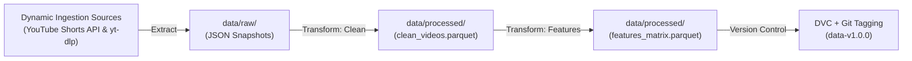
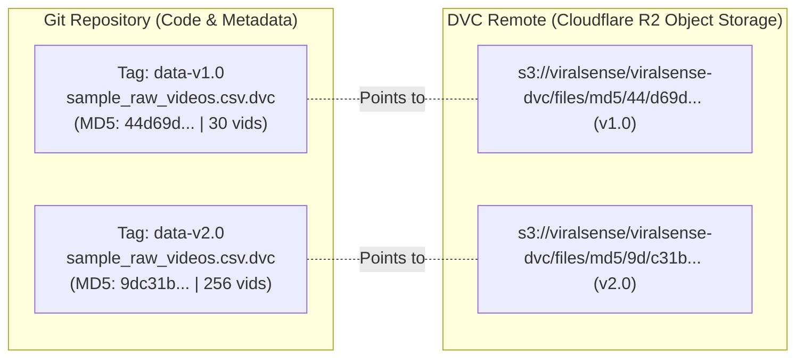

# ViralSense: Social Media Virality Prediction & Trend Saturation Detection Engine

[](https://www.python.org/downloads/release/python-3100/)
[](https://mlflow.org/)
[](https://github.com/features/codespaces)
[](https://opensource.org/licenses/MIT)

ViralSense is an end-to-end MLOps pipeline featuring continual learning capabilities, engineered to forecast early virality scores for short-form video content (YouTube Shorts) and identify trend lifecycle stages (early-rise, peak, and saturated). The system addresses real-world constraints such as label latency, concept drift, and API quota limits through an automated, staged machine learning workflow.

---

## Key Objectives & Problem Domain

The lifecycle of short-form digital content is exceptionally brief, often decaying within days or a few weeks before reaching audience fatigue. ViralSense resolves this bottleneck by:
* Predicting content virality early via interaction growth rates (views, likes, comments, shares).
* Classifying trend phases using the slope of virality scores over time.
* Mitigating label latency by isolating immature observations from final evaluation datasets during a 3–7 day maturation window.
* Monitoring covariate shift and concept drift to trigger adaptive model retraining.
* Assisting content creators and digital marketing teams in discovering emerging viral opportunities and optimizing promotional content strategies.

---

## Data Pipeline Architecture

Data is ingested periodically via an automated ETL pipeline, cleaned, feature-engineered, and versioned using DVC prior to consumption by machine learning models.



For complete technical specifications and architectural design, refer to **[docs/data_pipeline_architecture.md](docs/data_pipeline_architecture.md)**.

---

## Directory Structure

This repository adheres to the **Cookiecutter Data Science** standard:

```text
├── .devcontainer/         # GitHub Codespaces container setup and reproducibility config
├── config/                # Pipeline parameter files (config.yaml)
├── data/
│   ├── external/          # Auxiliary trend signals (Google Trends)
│   ├── processed/         # Cleaned, feature-engineered datasets (Parquet)
│   └── raw/               # Raw batch snapshots extracted from APIs and feeds
│       └── youtube/       # YouTube Shorts snapshots
├── docs/                  # Technical design and architecture documentation
├── models/                # Serialized model artifacts and experiment weights
├── notebooks/             # Exploratory Data Analysis (EDA) and prototype notebooks
├── src/                   # Production-grade source code
│   ├── __init__.py
│   ├── ingest_data.py     # Unified dynamic data ingestion & periodic simulation script
│   ├── preprocess.py      # Automated preprocessing (tokenization, stopwords, missing values)
│   ├── data/              # Modular data extraction and validation modules
│   │   ├── clean.py       # Data cleaning, deduplication, and schema validation
│   │   └── ingest_youtube.py # YouTube Data API v3 and trending ingestion
│   ├── features/          # Tabular metric computation and text vectorization
│   │   └── build_features.py # Velocity, engagement rates, and label generation
│   └── models/            # Staged regression and classification pipelines
├── .env.example           # Template for environment variables and API keys
├── .gitignore             # Standard Python/ML git ignore configuration
├── LICENSE                # Project license (MIT)
├── requirements.txt       # Core project dependencies
└── README.md              # Project documentation
```

---

## Pipeline Execution Guide

### 1. Environment Setup
Install project dependencies and configure environment variables:
```bash
cp .env.example .env
pip install -r requirements.txt
```

### 2. Data Ingestion (Dynamic & Continual Learning Ready)
Dynamic data extraction is orchestrated using `src/ingest_data.py`. This module pulls short-form content from **YouTube Shorts**, providing a non-destructive periodic simulation mechanism (*append-only timestamped snapshots*) to support **Continual Learning**.

```bash
# 1. Execute a single ingestion run for YouTube Shorts
python src/ingest_data.py --source youtube

# 2. Periodic simulation (Continual Learning: e.g., 3 cycles with a 5-second interval)
# Each cycle generates a distinct timestamped JSON snapshot without overwriting historical batches
python src/ingest_data.py --source youtube --runs 3 --interval 5
```

**Raw Snapshot Storage Layout:**
* `data/raw/youtube/{YYYY-MM-DD}/youtube_trending_{HHMMSS}.json`
* `data/raw/sample_raw_videos.csv` (consolidated sample snapshot in tabular CSV format)

### 3. Automated Preprocessing & NLP Cleaning
Raw data preprocessing is automated via `src/preprocess.py` to cleanse and prepare snapshots prior to feature extraction:

```bash
python src/preprocess.py
```

**Preprocessing Workflow:**
1. **Snapshot Aggregation**: Recursively ingests all historical snapshot batches from `data/raw/`.
2. **Missing Value Imputation**: Imputes numeric interaction metrics (`views`, `likes`, `comments`, `shares`) with `0` and trims whitespace on textual features.
3. **Composite Deduplication**: Eliminates duplicate entries based on `(platform, video_id)`, retaining the latest interaction snapshot.
4. **Short-Form Content Validation**: Filters and retains video content with duration $\le 60$ seconds.
5. **Text Sanitization & Hashtag Extraction**: Strips URLs, removes `@user` mentions, and parses hashtags into `extracted_hashtags`.
6. **Tokenization**: Splits clean sentences into word tokens populated in the `tokens` column.
7. **Stopword Removal**: Eliminates common Indonesian and English stopwords in-memory without external download dependencies, populating `clean_tokens` and `clean_text_final`.
8. **Dual-Format Export**: Persists clean data to `data/processed/clean_videos.parquet` (optimized for ML training) and `data/processed/clean_videos.csv` (human-readable inspection).

### 4. Feature Engineering
Compute velocity metrics (views/hour, likes/hour), engagement ratios, content signals, and virality ground-truth labels:
```bash
python src/features/build_features.py
```

### 5. Automated Pipeline Unit Testing
Execute the test suite to validate data schemas, missing value resilience, duration filtering, tokenization, stopword removal, and model training:
```bash
python -m unittest tests/test_data_pipeline.py
python -m unittest tests/test_train.py
```

### 6. Machine Learning Training & MLflow Experiment Tracking
Train virality prediction models, perform hyperparameter tuning across multiple algorithm families, log metrics/artifacts, and register the Champion model into the MLflow Model Registry:

```bash
# 1. Run full 5-experiment tuning suite & automatically register the Champion model:
python src/models/train.py --run_all --register_best

# 2. Or execute a single custom run:
python src/models/train.py --model_type gbm --n_estimators 150 --learning_rate 0.08 --max_depth 4

# 3. Launch the MLflow UI Dashboard:
mlflow ui --backend-store-uri sqlite:///mlflow.db --host 0.0.0.0 --port 5000
```

### 7. Model Registry, Versioning & Production Inference Readiness
ViralSense orchestrates the full model lifecycle using the **MLflow Model Registry** integrated with **DVC** to enforce rigorous stage transitions and preserve verifiable data lineage from raw snapshots to real-time production inference.

#### Registered Models & Active Production Versions:
* **Registered Model Name**: `ViralSense-ViralityClassifier`
* **Active Production Version**: **Version 2 (v2)** — Stage: `Production` (Aliases: `@production`, `@champion`)
* **Archived Version**: **Version 1 (v1)** — Stage: `Archived` (Alias: `@archived_v1`)

#### Why Version 2 Was Selected for Production:
Model Version 2 (`run6_gbm_optimized_v2_lr0.04_n220`) was selected and promoted to **Production** replacing Version 1 based on the following technical evaluation:
1. **Superior Discriminative Capability (ROC-AUC 0.9625 vs. 0.9508)**: Version 2 yields sharper probability separation between genuinely viral and non-viral content, providing greater stability across varying classification decision thresholds.
2. **Balanced Precision-Recall Profile (F1-Score: 0.8000, Recall: 85.71%)**: In short-form video virality forecasting, false negatives (missing an emerging viral video) incur substantially higher opportunity costs than false positives. Version 2 sustains high recall ($85.71\%$) alongside solid precision ($75.00\%$) and overall test accuracy of $95.59\%$.
3. **Tuned Regularization Hyperparameters**: Optimizing `n_estimators=220`, `learning_rate=0.04`, `max_depth=4`, and `subsample=0.85` ensures robust regularization, preventing overfitting on lexical signals and interaction ratios.

#### Model Lifecycle Stage Transition Workflow:
```text
[Experiment Suite / Run 6] 
       │ (Register Model)
       ▼
 [Stage: None] ──(Validation & Benchmarking)──► [Stage: Staging] ──(Promote Winner)──► [Stage: Production (v2 Active)]
                                                                                               │
                                                                             [Stage: Archived (v1 Archived)]
```

#### Programmatic Production Inference Verification:
The active Production model can be dynamically loaded and queried via `mlflow.pyfunc.load_model`:

```python
import mlflow.pyfunc
import pandas as pd

# 1. Configure MLflow tracking URI
mlflow.set_tracking_uri("sqlite:///mlflow.db")

# 2. Load the active Production model from the registry
model = mlflow.pyfunc.load_model("models:/ViralSense-ViralityClassifier/Production")

# 3. Formulate inference payload (YouTube Shorts features)
sample_payload = pd.DataFrame([{
    "duration_seconds": 15,
    "video_age_hours": 4.5,
    "engagement_rate": 0.125,
    "comment_to_like_ratio": 0.18,
    "caption_length": 95,
    "word_count": 14,
    "has_hook_question": 1
}])

# 4. Predict binary class (0 = Non-Viral, 1 = Viral)
prediction = model.predict(sample_payload)
print(f"Content Prediction: {'VIRAL' if prediction[0] == 1 else 'NON-VIRAL'}")
```

#### Running the Lifecycle Manager & Inference Verification Tools:
```bash
# 1. Inspect all registered model versions and stages:
python src/models/registry_manager.py --list

# 2. Synchronize active production metadata to YAML and DVC:
python src/models/registry_manager.py --sync_dvc

# 3. Execute real-time programmatic inference verification (latency < 3 ms):
python src/models/verify_inference.py

# 4. Run automated inference unit tests:
python -m unittest tests/test_inference.py
```

**Key Deliverables & Artifacts:**
* **Model Lineage Metadata (JSON)**: [`models/model_metadata.json`](models/model_metadata.json)
* **DVC Lineage Pointer**: [`models/production_model.yaml.dvc`](models/production_model.yaml.dvc) (linked to raw snapshot `sample_raw_videos.csv.dvc` / `data-v3.0`)


---


## Data Versioning Strategy (DVC) & Continual Learning

ViralSense implements **Data Version Control (DVC)** coupled with **Git Tagging** and **Cloudflare R2 Object Storage** to track binary dataset evolution without bloating repository size.

### Why Data Versioning is Critical for ML Reproducibility

In machine learning and MLOps, code versioning alone via Git is insufficient to reproduce model outputs. Data versioning plays a critical role because:

1. **Deterministic Model Training**:
   If models are retrained against changing datasets without tracking (*silent data drift*), performance metrics, weights, and evaluation scores cannot be reproduced. DVC locks cryptographic hashes (*MD5*) of each batch, guaranteeing 100% reproducible training in future runs.

2. **Mitigating Data Drift and Concept Drift in Continual Learning**:
   Short-form content dynamics shift rapidly (lifecycle decays within days). Tracking dataset releases (`data-v1.0` through `data-v3.0`) enables MLOps teams to monitor feature distribution shifts, detect *covariate shift*, and evaluate whether performance drops originate from audience habit changes or algorithmic degradation.

3. **Data Lineage and Auditability**:
   DVC connects registered models in MLflow to the exact raw snapshots (`data/raw/`) and feature matrices (`data/processed/`) used during training. This is essential for compliance audits, debugging, and model transparency.

4. **Zero-Downtime Dataset Rollback**:
   If a newly retrained model exhibits bias or anomalies in production, teams can instantly revert to a proven dataset state via `git checkout` and `dvc checkout` in seconds.

5. **Decoupled Storage Architecture**:
   Git is built for text files, not massive binary files. DVC offloads heavy binary payloads to external object storage (**Cloudflare R2**) and keeps only lightweight metadata pointer files (`.dvc`) in Git, keeping the repository lightweight and responsive.



### 1. Initial Dataset Baseline Tracking (v1.0)
1. **Initialize DVC**:
   ```bash
   dvc init
   git commit -m "chore: initialize DVC"
   ```
2. **Track Initial Baseline Dataset (YouTube Shorts Baseline)**:
   ```bash
   # Track raw dataset (30 YouTube Shorts videos)
   dvc add data/raw/sample_raw_videos.csv

   # Commit metadata pointer (.dvc) and .gitignore to Git
   git add data/raw/sample_raw_videos.csv.dvc data/raw/.gitignore
   git commit -m "feat(data): track initial baseline dataset v1.0 via DVC"
   git tag -a "data-v1.0" -m "Initial YouTube Shorts dataset baseline v1.0"
   ```

### 2. Continual Learning Simulation & Dataset Versioning (v2.0)
1. **Simulate Ingestion of Additional Batches**:
   Trigger the dynamic ingestion script to fetch recent YouTube Shorts:
   ```bash
   python src/ingest_data.py --source youtube
   ```
   The consolidated snapshot `data/raw/sample_raw_videos.csv` grows from 31 rows (30 videos) to 257 rows (256 videos).

2. **Detect Changes with DVC**:
   ```bash
   dvc status
   # Output: data/raw/sample_raw_videos.csv.dvc: modified: data/raw/sample_raw_videos.csv
   ```

3. **Track Updated Dataset Version**:
   ```bash
   # Update DVC tracking to the latest snapshot
   dvc add data/raw/sample_raw_videos.csv

   # Commit new pointer to Git and tag as release v2.0
   git add data/raw/sample_raw_videos.csv.dvc
   git commit -m "feat(data): track updated dataset v2.0 after continual learning ingestion"
   git tag -a "data-v2.0" -m "Updated YouTube Shorts dataset v2.0 after continual learning"
   ```

### 3. Auditing, Diffing, and Version Rollbacks
* **Compare Dataset Versions (Metadata Diff)**:
  ```bash
  dvc diff data-v1.0 data-v2.0
  # Output: Modified: data/raw/sample_raw_videos.csv (1 modified)

  git diff data-v1.0 data-v2.0 data/raw/sample_raw_videos.csv.dvc
  # Shows MD5 hash change (44d69db... -> 9dc31b...) and file size update (8.4 KB -> 47.4 KB)
  ```

* **Rollback / Switch Dataset Version**:
  Revert the dataset state to version 1.0 at any point:
  ```bash
  git checkout data-v1.0 data/raw/sample_raw_videos.csv.dvc
  dvc checkout
  # The dataset automatically restores to the initial 30-row baseline (8.4 KB)
  ```

### 4. Remote Storage Configuration (Cloudflare R2 / S3-Compatible)
Binary datasets are synchronized to **Cloudflare R2** using S3-compatible protocols:

```bash
# 1. Register Cloudflare R2 remote as default remote
dvc remote add -d r2-storage s3://viralsense/viralsense-dvc
dvc remote modify r2-storage endpointurl https://<ACCOUNT_ID>.r2.cloudflarestorage.com

# 2. Configure local credentials (.dvc/config.local is gitignored for security)
dvc remote modify --local r2-storage url s3://viralsense/viralsense-dvc
dvc remote modify --local r2-storage endpointurl https://<ACCOUNT_ID>.r2.cloudflarestorage.com
dvc remote modify --local r2-storage access_key_id <R2_ACCESS_KEY_ID>
dvc remote modify --local r2-storage secret_access_key <R2_SECRET_ACCESS_KEY>

# 3. Synchronize datasets with cloud storage
dvc push
dvc pull
```

---

## License

This project is licensed under the MIT License - see the [LICENSE](LICENSE) file for details.
